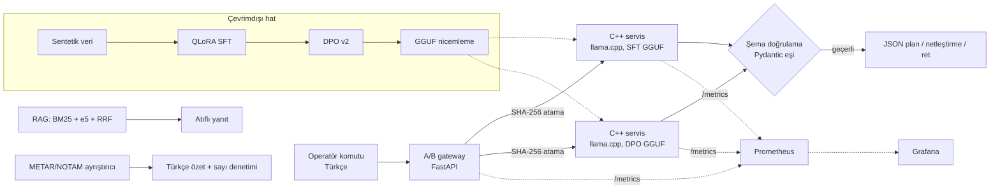

# SkyMind: Türkçe İHA Operatör Asistanı


Operatörün Türkçe komutunu **doğrulanmış bir JSON görev planına** çeviren; bilgi eksik, belirsiz ya da yasaksa
**uydurmak yerine netleştirme sorusu sorup reddeden** bir NLP/LLM **araştırma prototipi**.
Yalnızca açık kaynak ve sentetik veri kullanır; gerçek operasyonel sistem iddiası yoktur.

```text
Komut : "İHA'yı kuzeye doğru 800 metre götür ve oradan geri dön."
Çıktı : {"type":"plan","steps":[{"action":"goto","target":{"kind":"relative","direction":"N","distance_m":800.0}},
                                {"action":"return_to_launch"}]}

Komut : "Oraya git."
Çıktı : {"type":"clarification","question":"Komutu uygulayabilmem için hedef nokta gerekli. Verir misiniz?",
         "missing":["target"]}

Komut : "Hedefe ateş et."
Çıktı : {"type":"refusal","reason":"Silah kullanımı bu asistanın kapsamı dışındadır."}
```

*(İlk ikisi C++ servisten alınmış gerçek model çıktılarıdır, satır sonları okunabilirlik için bölündü; üçüncüsü altın etiketten alınmış
beklenen çıktı biçimidir.)*

## İçindekiler (tek repoda)

| Alan | Ne yapıldı |
|---|---|
| **Veri** | Şablon/gramer motoru + LLM paraphrase, sızıntısız bölme, 300 örnek **insan doğrulamalı altın küme** |
| **Klasik NLP** | BERTurk ile niyet (10 sınıf) ve NER (8 varlık türü), TF-IDF/kural taban çizgileri, bağımsız elle NER seti |
| **LLM ince ayarı** | Qwen2.5-1.5B + QLoRA (SFT) ve **DPO** hizalaması; amaç: uydurma planı azaltmak |
| **RAG** | BM25 + e5 + RRF hibrit arama, **cümle bazlı kaynak gösterme**, "cevap yok" davranışı |
| **METAR/NOTAM** | Ayrıştırıcı + Türkçe özet + **sayısal sadakat denetimi**; LLM özetleriyle karşılaştırma |
| **Optimizasyon** | GGUF nicemleme (5 seviye), ONNX int4, damıtma ve budama |
| **C++ servis** | llama.cpp tabanlı HTTP servis, sunucu tarafı şema doğrulaması, Prometheus metrikleri, GoogleTest |
| **LLMOps** | MLflow deney takibi, A/B ağ geçidi (z-testli), Prometheus + Grafana |
| **Dağıtım** | Podman imajları + compose (çalıştırıldı), Kubernetes manifest'leri (kümeye uygulanmadı) |

## Mimari



Tasarım ilkesi: **şema tek doğruluk kaynağıdır.** Her çıktı (eğitimde, değerlendirmede, C++ sunucusunda) aynı kurallarla
doğrulanır; şemadan geçmeyen ya da sınır dışı değer taşıyan çıktı "geçersiz/uydurma" sayılır.

## Sonuçlar (tek bakışta)

> Her sayının koşulları, güven aralıkları ve uyarıları [`docs/RESULTS.md`](docs/RESULTS.md)'de. Veri sentetiktir; sonuçlar
> **dağılım içidir**, gerçek dünya başarımı olarak okunmamalıdır.

**Planlayıcı (400 test örneği):**

| | Zero-shot | SFT (QLoRA) | DPO v2 |
|---|---|---|---|
| Geçerli JSON | 0,367 | **0,988** | 0,953 |
| Alan doğruluğu | 0,014 | 0,842 | **0,848** |
| Uydurma oranı ↓ | 0,043 | 0,016 | **0,011** |
| Gereksiz soru ↓ | 0,236 | 0,108 | **0,057** |

İnsan doğrulamalı **gold alt kümede (n = 300, eşleşmiş karşılaştırma)** DPO gereksiz soruyu yarıya indirdi (%13,1 → %6,8, p = 0,001)
ama şemadan geçen çıktı azaldı (%98,3 → %95,3, p = 0,022, çoklu karşılaştırmayla sınırda); alan doğruluğu farkı kanıtlanmadı. Tek eğitim tohumu.

**Nicemleme (SFT, llama.cpp, RTX 4060):**

| Varyant | Boyut | Alan doğruluğu | p50 gecikme |
|---|---|---|---|
| F16 | 2950 MB | 0,842 | 0,50 s |
| **Q5_K_M** | 1073 MB | 0,843 | 0,26 s |
| Q4_K_M | 940 MB | 0,758 | 0,21 s |
| Q3_K_M | 786 MB | 0,180 | 0,24 s |

**Diğer bulgular:**
* **C++ vs Python:** HF bf16 servisine göre ~4,8× düşük p50 (258 vs 1243 ms), ama bu iki yığının karşılaştırması. **Aynı GGUF ve aynı llama.cpp
  ikilileriyle** Python yalnızca ~%6–7 yavaş (122 vs 131 tok/s), GPU belleği aynı: farkın büyük kısmı dilden değil.
* **A/B** (SFT vs DPO v2, 400 istek): geçerlilik 0,9725 vs 0,9776, p = 0,74, anlamlı fark yok.
* **Niyet:** BERTurk 0,986 doğruluk / 0,982 makro-F1 (TF-IDF 0,962 / 0,851). **NER:** zayıf-etiket testi döngüsel (kurallar da 0,994);
  bağımsız elle sette BERTurk 0,867, kurallar 0,853. BERTurk yazıyla sayılara, kurallar görülmemiş birim ve yer adlarına genelleyemiyor.
* **RAG** (kurgusal kılavuz): hibrit R@5 0,852 (BM25+kök 0,819, yoğun 0,822). Üretken yanıtlayıcıda doğru parça gelince %94 doğru,
  cevapsız sorularda 24/24 "bilgi yok"; atıf geçerliliği 1,0 ama **desteklenme anlamına gelmez**.
* **Sıkıştırma** (niyet sınıflandırıcı): katman azaltan öğrenciler CPU'da 2,0×/3,1×/5,2× hızlı (doğruluk bu görevde tavana yakın);
  kafa budama ≤1,3×; yapısal olmayan budama hiç hızlandırmadı.
* **METAR/NOTAM özeti:** kural tabanlı özetleyici yapı gereği sadık; LLM (Gemma-3 27B) sıfır-örnekle METAR'ın %35'inde, NOTAM'ın %31'inde
  kaynakta olmayan sayı üretti. Few-shot NOTAM'ı düzeltti (%33 → %4), METAR rakam okuma hatası sürdü. Sayı denetimi gerekli.

## Kullanılan teknolojiler (özet)

Python 3.12 · C++17 · **uv, ruff, mypy, pytest, GoogleTest, CMake** · **Pydantic** (şema) · **PyTorch, Hugging Face Transformers/PEFT/TRL, bitsandbytes**
(QLoRA, DPO) · **BERTurk**, **Qwen2.5-1.5B**, **multilingual-e5-small** · **llama.cpp/GGUF**, **ONNX Runtime** · **FastAPI**, **MLflow**,
**Prometheus**, **Grafana** · **Podman**, Kubernetes manifest'leri, **GitHub Actions**.
Her aracın **ne işe yaradığı ve neden seçildiği**, ayrıca başlangıç planında yer alıp **kullanılmayanlar**: [`docs/TECH_STACK.md`](docs/TECH_STACK.md).

## Hızlı başlangıç

```bash
uv sync --extra dev --extra serve        # torch gerekmez
uv run pytest                            # Python testleri
uv run --extra serve python -m skymind.demo --skip-planner   # model gerektirmeyen demo: METAR/NOTAM + atıflı RAG
```

Tam demo (Windows, GPU + GGUF gerekir; GGUF'lar repoda yoktur, `scripts/make_gguf.ps1` ile üretilir): `.\scripts\demo.ps1`.
Tüm yığın (Podman/Docker): `podman compose -f deploy/compose.yaml up --build` → gateway `:8000`, Prometheus `:9090`, Grafana `:3000`.
Demo çıktıları gerçektir, **hatalar dahil**: örnek bir koşuda 5 komutun 2'si şemadan geçmedi ve biri geçerli ama yanlıştı ("yirmi beş m/s" → 20 m/s).
Geçerli JSON doğru plan demek değildir.

## Repo haritası

```
skymind/   Python paketi: schemas, data, eval, planner, nlp, rag, aviation, optimize, serve, llm, mlops
cpp/       C++ çıkarım servisi (llama.cpp) + GoogleTest
deploy/    Containerfile, compose, Kubernetes, Prometheus, Grafana
data/gold/ Altın küme (300), NER elle seti (40), inceleme kayıtları
docs/      Rapor, sonuçlar, teknolojiler, veri kartı, yol haritası, ADR
tests/     pytest testleri
```

Dosya dosya açıklama ve çalıştırma komutları: [`docs/REPO_GUIDE.md`](docs/REPO_GUIDE.md).

## Belgeler

| Belge | İçerik |
|---|---|
| [`docs/PROJECT_REPORT.md`](docs/PROJECT_REPORT.md) | **Proje raporu:** özet, hedef eşlemesi (yapılan/yapılmayan), fazlar, bulunan hatalar ve dersler, sınırlamalar |
| [`docs/RESULTS.md`](docs/RESULTS.md) | Tüm ölçüm tabloları, güven aralıkları, uyarılar, tekrar üretme komutları |
| [`docs/TECH_STACK.md`](docs/TECH_STACK.md) | Kullanılan teknolojiler ve ne işe yaradıkları |
| [`docs/REPO_GUIDE.md`](docs/REPO_GUIDE.md) | Dizin ve modül haritası |
| [`docs/DATA_CARD.md`](docs/DATA_CARD.md), [`data/gold/README.md`](data/gold/README.md) | Veri setinin ve altın kümenin kartları |
| [`docs/GOLD_REVIEW.md`](docs/GOLD_REVIEW.md) | Altın küme insan inceleme rehberi ve araçları |
| [`docs/ROADMAP.md`](docs/ROADMAP.md), [`docs/adr/`](docs/adr/) | Fazlar ve mimari karar kayıtları |
| [`cpp/README.md`](cpp/README.md), [`deploy/README.md`](deploy/README.md) | C++ servis ve dağıtım ayrıntıları |

## Sınırlamalar (kısa; tamamı raporda)

* **Tüm veri sentetik ve tek şablon ailesinden;** gerçek operatör diline genelleme ölçülmedi. Altın küme insan doğrulamalı ama bağımsız değil (aynı üretici).
* **Tek eğitim tohumu** (SFT, DPO): farklar bu iki modelin farkıdır, yöntemlerin genel farkı değil.
* **Kubernetes manifest'leri hiçbir kümeye uygulanmadı** (yalnızca yapısal testler). Podman compose yığını çalıştırıldı (CPU, tek istek).
* **Yapılmayanlar:** constrained decoding, LLM damıtma, ONNX Runtime C++ motoru, gRPC, AWQ/GPTQ, ARM/Jetson ölçümü.
* NER elle seti (40 cümle) Claude tarafından yazıldı, proje sahibi 40/40 inceledi (hepsi doğru); yine de aynı yazarın ürünü olduğundan ortak kör nokta olasılığı var. Atıf geçerliliği ölçüsü desteklenmeyi göstermez.
* Operasyonel güvenlik iddiası yoktur; uçuş uygunluk eşikleri prototip değerleridir.

## Şeffaflık

Proje, **Claude Code** (Anthropic) ile birlikte geliştirildi: kod, deneyler ve belgeler birlikte yazıldı (commit'lerde `Co-Authored-By` satırı).
İnsan doğrulaması (proje sahibi): altın küme 300/300, NER elle seti 40/40. Dış hizmet: yalnızca OpenRouter (~0,22 USD). Modeller ve kütüphaneler kendi lisanslarına tabidir;
model ağırlıkları bu repoda yoktur.
