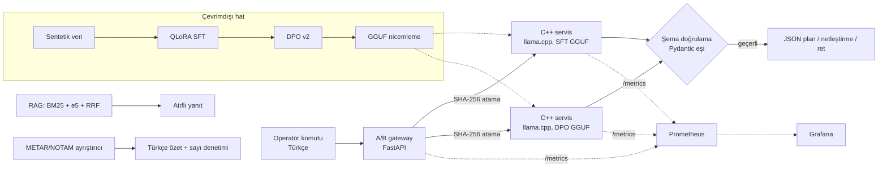

# SkyMind — Türkçe İHA Operatör Asistanı

Operatörün Türkçe komutunu doğrulanmış bir **JSON görev planına** çeviren, eksik/belirsiz komutta uydurmak
yerine **netleştirme sorusu** soran bir NLP/LLM araştırma prototipi. Yalnızca açık kaynak ve sentetik veri
kullanır; gerçek operasyonel sistem iddiası yoktur.

> Durum: Faz 0–7 büyük ölçüde tamam (veri, SFT, DPO, niyet/NER, RAG, METAR/NOTAM, nicemleme,
> damıtma/budama, C++ servis, A/B, Podman yığını, demo). Kalan: Kubernetes kümesi denemesi, altın set
> gözden geçirme. Plan ve ilerleme: [`docs/ROADMAP.md`](docs/ROADMAP.md).
> Kararlar: [`docs/adr/`](docs/adr/). Tüm sonuçlar ve uyarılar: [`docs/RESULTS.md`](docs/RESULTS.md).

## Mimari



Planlayıcı (Qwen2.5-1.5B, QLoRA SFT, DPO) komutu JSON plana çevirir; çıktı hem sunucuda (C++ doğrulayıcı,
Pydantic ile eşlik testli) hem değerlendirmede şemadan geçirilir. RAG ve METAR/NOTAM hatları planlayıcıdan
bağımsızdır.

## Demo

```bash
# Windows: C++ sunucuyu başlatır, 5 komutu gönderir, METAR/NOTAM ve RAG örneklerini gösterir, sunucuyu kapatır
.\scripts\demo.ps1
# Model gerektirmeyen kısımlar (METAR/NOTAM, atıflı RAG):
uv run --extra serve python -m skymind.demo --skip-planner
```

Gösterilen çıktılar gerçektir, **hatalar dahil**: örnek bir koşuda 5 komutun 2'si şema doğrulamasından geçmedi
(`scan` adımında eksik `altitude_m`; "5 metre alçak geçiş" için sınır altı irtifa) ve biri şemadan geçip yine de
yanlıştı ("yirmi beş m/s" için 20 m/s). Geçerli JSON doğru plan demek değildir.

## Sınırlamalar (kısa)

* Tüm veri sentetik; test seti dağılım içi. 300 örneklik altın küme proje sahibi tarafından **insan doğrulamasından
  geçti (300/300)** ama bağımsız değil: aynı şablon üreticisinden, test bölümünün şablon alt kümesi. 23 kart gri alan
  (şablon varsayımı, etiket hatası değil), bkz. `data/gold/README.md`.
* Planlayıcı için tek eğitim tohumu; SFT/DPO farkları küçük (A/B'de anlamlı değil, p = 0.74).
* C++ vs HF servis farkı (~4.8×) iki yığını birden karşılaştırır; aynı GGUF ve aynı llama.cpp ikilileriyle ölçülen saf
  dil payı ~%6–7'dir. Python servisinin ana bellek (RAM) ölçümü geçersiz çıktı, raporlanmıyor.
* Podman imajları derlendi ve compose yığını çalıştırıldı (yalnızca CPU, tek istek); **Kubernetes manifest'leri
  hiçbir kümeye uygulanmadı** (yalnızca yapısal testler). GitHub Actions'ta CI çalıştırılmadı.
* NER elle sınama seti (42 cümle) asistan tarafından yazıldı. Atıf geçerliliği ölçüsü desteklenmeyi göstermez.
* Operasyonel güvenlik iddiası yoktur; uçuş uygunluk eşikleri prototip değerlerdir.

## Planlayıcı sonuçları (400 test örneği)

| | Zero-shot | SFT (QLoRA) | DPO v2 |
|---|---|---|---|
| Geçerli JSON | 0.367 | **0.988** | 0.953 |
| Alan doğruluğu | 0.014 | 0.842 | **0.848** |
| Uydurma oranı ↓ | 0.043 | 0.016 | **0.011** |
| Gereksiz soru ↓ | 0.236 | 0.108 | **0.057** |

SFT dağıtım adayı. Saf DPO şemayı bozdu, SFT kaybı eklenen v2 yapıyı korudu ama geçerlilikte SFT'nin
gerisinde kaldı. Test seti sentetik/dağılım içi, fark küçük örneklemde: ayrıntı ve uyarılar
[`docs/RESULTS.md`](docs/RESULTS.md)'de.

**İnsan doğrulamalı gold alt kümede (n = 300, eşleşmiş karşılaştırma):** DPO v2 gereksiz soruyu yarıya indirdi
(%13,1 → %6,8, McNemar p = 0,001) ama şemadan geçen çıktı azaldı (%98,3 → %95,3, p = 0,022, çoklu karşılaştırma
düzeltmesiyle sınırda); alan doğruluğu farkı (+2,4 puan) güven aralığı sıfırı içerdiği için kanıtlanmadı. Tek eğitim tohumu.

## Hızlı başlangıç

```bash
uv sync --extra dev
uv run pytest
```

## Yapı

```
skymind/    Python paketi (schemas, data, eval, planner, nlp, optimize, serve, rag, aviation, demo)
cpp/        C++ çıkarım servisi (llama.cpp) + GoogleTest, bkz. cpp/README.md
deploy/     A/B ağ geçidi, Prometheus/Grafana, Containerfile, compose, K8s, bkz. deploy/README.md
tests/      pytest testleri
docs/       yol haritası, ADR'ler, sonuçlar
```

Tüm deney komutları `docs/RESULTS.md` içindeki "Tekrar üretme" bölümlerindedir.

## Nicemleme (SFT modeli, llama.cpp, RTX 4060)

| Varyant | Boyut | Alan doğruluğu | p50 gecikme |
|---|---|---|---|
| F16 | 2950 MB | 0.842 | 0.50 s |
| **Q5_K_M** | 1073 MB | 0.843 | 0.26 s |
| Q4_K_M | 940 MB | 0.758 | 0.21 s |
| Q3_K_M | 786 MB | 0.180 | 0.24 s |

Q5_K_M doğruluğu koruyup boyutu %64 küçültüyor; Q4'ten itibaren model gereksiz soruya kayıyor.
Ayrıntı ve uyarılar: [`docs/RESULTS.md`](docs/RESULTS.md).

CPU'da ONNX Runtime int4 (937 MB, 25 tok/s, alan doğruluğu 0.854) ile llama.cpp Q4_K_M (940 MB, 31 tok/s, 0.703)
karşılaştırıldı; ONNX int4 gereksiz soruyu azaltıyor ama daha sık uyduruyor (0.037). Ayrıntı: `docs/RESULTS.md`.

## Diğer sonuçlar (özet; ayrıntı ve uyarılar `docs/RESULTS.md`'de)

* **C++ vs Python servis** (aynı GPU, batch 1): tek istekte p50 258 ms (llama.cpp Q5_K_M) vs 1243 ms (HF bf16),
  ~4.8×; fark çoğunlukla HF yığını ve model biçimi. **Aynı GGUF ve aynı llama.cpp ikilileriyle** Python (FastAPI +
  llama-cpp-python) yalnızca ~%6–7 daha düşük verim verdi (122 vs 131 tok/s), GPU belleği aynı.
* **A/B** (SFT vs DPO v2, 400 istek): geçerlilik 0.9725 vs 0.9776, p = 0.74, anlamlı fark yok.
* **Niyet** (BERTurk): doğruluk 0.986, makro-F1 0.982 (TF-IDF: 0.962 / 0.851). **NER**: zayıf-etiket testi
  döngüsel (kurallar da 0.994); elle yazılmış zor sette BERTurk 0.867 vs kurallar 0.853.
* **RAG** (kurgusal kılavuz): hibrit R@5 0.852 (BM25 0.819/0.822). Üretken yanıtlayıcıda doğru parça gelince
  doğruluk 0.94, cevapsız sorularda vazgeçme 24/24; atıf geçerliliği 1.0 ama desteklenme ölçülmedi.
* **Sıkıştırma** (niyet sınıflandırıcı): katman azaltan öğrenciler CPU'da 2.0×/3.1×/5.2× hızlı, doğruluk bu görevde
  tavana yakın (fark gürültü düzeyinde); kafa budama ≤1.3×, yapısal olmayan budama hız kazandırmaz.
* **METAR/NOTAM özeti:** kural tabanlı özetleyici sayısal olarak sadık (yapı gereği). LLM (gemma-3 27B) sıfır-örnekle
  80 METAR'ın %35'inde, 48 NOTAM'ın %31'inde kaynakta olmayan sayı üretti (NOTAM tarih kodunu sık yanlış okuyor).
  Few-shot prompt (yeni tohumda ölçüldü) NOTAM'da uydurma sayıyı %33 → %4'e indirdi ama METAR rakam okuma hataları
  sürdü (%20 → %19); 4B daha kötü. Sayı denetimi hâlâ gerekli.
