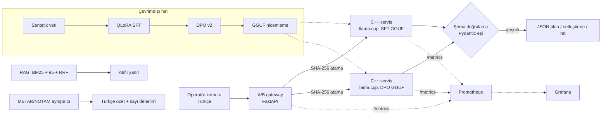

# SkyMind: proje raporu

> Türkçe İHA operatör asistanı. **Araştırma prototipi**: yalnızca açık kaynak ve sentetik veri; gerçek operasyonel
> sistem iddiası yoktur. Ayrıntılı tablolar ve tekrar üretme komutları: [`RESULTS.md`](RESULTS.md).
> Teknolojiler: [`TECH_STACK.md`](TECH_STACK.md). Dosya haritası: [`REPO_GUIDE.md`](REPO_GUIDE.md).

## 1. Özet

Operatörün Türkçe komutunu **doğrulanmış bir JSON görev planına** çeviren; bilgi eksik, belirsiz ya da yasaksa
**uydurmak yerine netleştirme sorusu sorup reddeden** bir sistem. Aynı repoda klasik NLP (niyet/NER), LLM ince ayarı ve
DPO hizalaması, kaynak gösteren RAG, METAR/NOTAM özetleme, çıkarım optimizasyonu (nicemleme, damıtma, budama, ONNX),
C++ çıkarım servisi, A/B testi, izleme ve konteyner dağıtımı yer alır.

**Öne çıkan bulgular (hepsi uyarılarıyla `RESULTS.md`'de):**
1. **SFT planlayıcı** (Qwen2.5-1.5B, QLoRA): geçerli JSON %98,8, alan doğruluğu %84,2; zero-shot'ta %36,7 / %1,4.
2. **DPO** gereksiz soruyu yarıya indirdi (gold'da %13,1 → %6,8, eşleşmiş testle p = 0,001) ama şema geçerliliğini düşürdü
   (%98,3 → %95,3). Saf DPO şemayı bozdu; SFT kaybı eklenen v2 bunu sınırladı. Tek eğitim tohumu.
3. **Nicemleme:** Q5_K_M doğruluğu koruyup (0,843 vs 0,842) boyutu %64 küçülttü ve gecikmeyi yarıya indirdi; Q4'ten itibaren
   model gereksiz soruya kayıyor, Q3'te çöküyor (0,180).
4. **C++ vs Python:** HF bf16 servisine göre ~4,8× düşük p50, **ama farkın büyük kısmı dilden değil**: aynı GGUF ve aynı
   llama.cpp ikilileriyle Python yalnızca ~%6–7 yavaş.
5. **Sıkıştırma (niyet sınıflandırıcı):** katman azaltan öğrenciler CPU'da 2,0×/3,1×/5,2× hızlı (doğruluk bu görevde tavana
   yakın); kafa budama ≤1,3×; yapısal olmayan budama hiç hızlandırmadı.
6. **LLM özeti güvenilmez:** METAR/NOTAM'ı özetleyen LLM sayı uyduruyor (27B sıfır-örnek: METAR %35, NOTAM %31); few-shot NOTAM'ı
   düzeltti (%33 → %4), METAR rakam okuma hataları sürdü. Kural tabanlı özetleyici yapı gereği sadık.
7. **Birçok ilk sonuç yanlış çıktı ve düzeltildi** (bölüm 5): veri hatası, döngüsel NER etiketleri, kirli sıkıştırma deneyi, gevşek
   denetleyiciler. Bunlar projenin en öğretici kısmı.

## 2. Hedefler ve durumları

| Hedef | Durum | Nerede | Not |
|---|---|---|---|
| Veri: sentetik komut→plan (~5–10k), elle kalite kontrol | ✅ | `skymind/data/`, `docs/DATA_CARD.md` | 6000 şablon komut + Gemma-3 paraphrase; **300 altın örnek insan doğrulamalı** |
| Niyet sınıflandırma + NER (BERTurk) | ✅ | `skymind/nlp/` | NER'de zayıf etiket döngüsel; bağımsız 40 cümlelik elle set eklendi |
| Planlayıcı LLM (Qwen 1–3B + QLoRA) | ✅ | `skymind/planner/` | Qwen2.5-1.5B-Instruct. **Constrained decoding yapılmadı** |
| Alignment (DPO) | ✅ | `planner/dpo.py` | v1 (saf) şemayı bozdu, v2 (+SFT kaybı) düzeltildi |
| RAG (hibrit, atıf, değerlendirme) | ✅ kısmen | `skymind/rag/` | BM25 + e5 + RRF, cümle atıfı. **Qdrant/FAISS ve RAGAS kullanılmadı** (kendi ölçüler) |
| Özetleme (NOTAM/METAR) | ✅ | `skymind/aviation/` | Kural tabanlı + LLM karşılaştırması. **TR↔EN çeviri yok** |
| Optimizasyon: nicemleme tablosu | ✅ kısmen | `optimize/`, `RESULTS.md` | GGUF (5 seviye) + ONNX int4. **AWQ/GPTQ/INT8 yok** |
| Optimizasyon: damıtma + budama | ✅ | `nlp/compress*.py` | Sınıflandırıcıda. **LLM damıtma (1,5B→0,5B) yapılmadı** |
| C++ servis (llama.cpp + ONNX Runtime) | ✅ kısmen | `cpp/` | llama.cpp ✅, HTTP ✅, GoogleTest ✅. **ONNX Runtime C++ ve gRPC yok** |
| C++ vs Python gecikme **ve bellek** | ✅ kısmen | `RESULTS.md` Faz 7 | Gecikme ✅; GPU belleği ✅; **Python ana-bellek ölçümü geçersiz** |
| LLMOps: deney takibi, A/B, izleme | ✅ | `mlops/`, `serve/gateway.py`, `deploy/` | MLflow (registry kullanılmadı); A/B + Prometheus + Grafana |
| Altyapı: konteyner | ✅ | `deploy/` | Podman'da derlendi, **compose yığını çalıştırıldı** |
| Altyapı: Kubernetes | ⚠️ yarım | `deploy/k8s/` | Manifest'ler yazıldı, yapısal test; **kümeye uygulanmadı** |
| Altyapı: GitHub Actions | ✅ | `.github/workflows/ci.yml` | Temiz ortamda taklit edildi; gerçek koşu push sonrası |
| ARM / Jetson ölçümü | ❌ | | Donanım yok |
| Tek komut demo | ✅ | `scripts/demo.ps1`, `deploy/compose.yaml` | |

## 3. Mimari

Tasarım ilkesi: **şema tek doğruluk kaynağı.** Her çıktı (eğitimde, değerlendirmede, C++ sunucusunda) aynı kurallarla doğrulanır;
şemadan geçmeyen ya da sınır dışı değer taşıyan çıktı "uydurma/geçersiz" sayılır. C++ doğrulayıcı, Pydantic ile 263 vakada
eşlik testinden geçer.

## 4. Fazlar: ne yapıldı, ne bulundu

**Veri.** Önce plan örneklenir, komut sonra yazılır (etiket hatası tanım gereği yok). 6000 komut, 9832 geçerli LLM paraphrase;
sızıntısız bölme: train 11.670 / val 1.488 / test 1.477. 300 şablon-kaynaklı test örneği altın küme adayı.
Kategoriler: plan %60, netleştirme %25, ret %15.

**Planlayıcı (SFT, DPO).** Qwen2.5-1.5B, QLoRA (4-bit, rank 16). Test (400): SFT geçerli 0,988 / alan 0,842 / uydurma 0,016 /
gereksiz soru 0,108; DPO v2 0,953 / 0,848 / 0,011 / 0,057. A/B denemesinde (400 istek, iki GGUF) geçerlilik farkı anlamlı değil (p = 0,74).
Gold (300, eşleşmiş test): DPO gereksiz soruda belirgin iyi (p = 0,001), geçerlilikte SFT iyi (p = 0,022, çoklu karşılaştırmayla sınırda).

**Altın küme.** 300 aday proje sahibi tarafından web arayüzüyle incelendi (300/300 doğru). Claude ön-incelemesi hata bulmadı ve
**23 gri alan kartı** işaretledi (şablon varsayımları: "havada kal"+yer yok, ret önceliği, "geri dön", yön-var-mesafe-yok). Bunlar etiket hatası
değil, belgelenmiş varsayımlardır. Küme bağımsız değil (aynı üretici). Ayrıntı: `data/gold/README.md`.

**Klasik NLP.** Niyet: BERTurk 0,986 doğruluk / 0,982 makro-F1 (TF-IDF 0,962 / 0,851). NER: zayıf-etiket testi döngüsel (kural tabanlı da
0,994); bağımsız 40 cümlelik elle sette BERTurk 0,867, kurallar 0,853. Hata analizi: BERTurk yalnızca **yazıyla sayılarda** (4 cümle)
ayrışıyor, kurallar birim ve yer adı görmediğinde (8 cümle). Benzer toplam skor farklı hataları gizliyor.

**RAG.** Kurgusal "SkyMind X1/X2/X3" kılavuzu (üç model bilerek yakın, çeldirici). Hibrit R@5 0,852 (BM25+kök 0,819, yoğun e5 0,822; 8 korpus tohumu; R@1 farkları küçük ve anlamlı değil).
Üretken yanıtlayıcı (Gemma-3-27B): doğru parça geldiğinde %94 doğru, cevapsız sorularda 24/24 "bilgi yok". Atıf geçerliliği 1,0 **ama desteklenme
anlamına gelmez**: yanlış parçadan makul görünen yanlış cevap geçerli atıfla verilebiliyor.

**METAR/NOTAM.** Kural tabanlı özet yapı gereği sadık. LLM'de en sık hatalar: NOTAM tarih kodunu yanlış okuma (YYAAGGSSdd), konumu FIR kodu
sanma, `BKN002`→"2000 ft", `M07`→eksi işareti kaybı. Few-shot NOTAM'da sayı uydurmayı %33'ten %4'e indirdi; METAR'da düzeltmedi.

**Optimizasyon.** Nicemleme (SFT, RTX 4060): F16 2950 MB / 0,50 s; Q5_K_M 1073 MB / 0,26 s (doğruluk aynı); Q4_K_M 940 MB (0,758); Q3_K_M (0,180).
ONNX int4 (CPU) 937 MB, 25 tok/s, alan 0,854, gereksiz soruyu azaltıyor ama daha çok uyduruyor. Sıkıştırma: bölüm 1, madde 5.

**C++ servis ve karşılaştırma.** llama.cpp Q5_K_M, tek istekte p50 258 ms (HF bf16: 1243 ms). Aynı GGUF/ikililerle Python: 122 vs 131 tok/s, GPU belleği
aynı. Çıktı eşitliği 58/60; 2 örnek küçük sayısal farkla ayrıştı. Eşzamanlılıkla verim artmıyor (batch=1, tek bağlam), gecikme doğrusal artıyor.

**Dağıtım ve izleme.** Podman (rootless, WSL2) ile imajlar derlendi, compose yığını (2 C++ arka uç + gateway + Prometheus + Grafana) çalıştırıldı;
gateway → C++ → geçerli plan; Prometheus hedefleri, 4 alarm kuralı ve 12 pano sorgusu canlı doğrulandı. Linux'ta C++ testleri (15) CI komutlarıyla geçti.

## 5. Süreçte bulunan hatalar ve dersler

Bu projede güvenilir sonuç almak için ölçümlerin kendisini defalarca düzeltmek gerekti. En önemlileri:

| Sorun | Nasıl bulundu | Sonuç |
|---|---|---|
| **485 bozuk paraphrase satırı** (`{style, command}` nesneleri metne çevrilmişti) | Veri incelemesi | Ayrıştırıcı düzeltildi, bölümler yeniden üretildi, planlayıcılar yeniden ölçüldü; bulgular değişmedi (alan 0,842/0,850) |
| **NER'in zayıf etiketleri döngüsel** (BERTurk 0,999, kural tabanlı da 0,994) | Kural taban çizgisinin yüksek çıkması | Bağımsız 40 cümlelik elle set; BERTurk'ün üstünlüğü kanıtlanamadı |
| **İlk sıkıştırma deneyi kirliydi** (öğrenciler öğretmenin ağırlıklarından başlamış, gecikme ben başka iş yaparken ölçülmüştü) | Deney tasarımı incelemesi | İki aşamaya ayrıldı, kontrol (`teacher-ft1`), 2 tohum, dönüşümlü gecikme |
| **Sayı denetleyicisi çok gevşek, sonra çok katıydı** | LLM özetlerinde sahte "uydurma" ve gevşek geçişler | Meşru biçim farkları (saat bileşenleri, koordinat parçaları, ay adları) eklendi; **bu düzeltme sonuçlar görüldükten sonra yapıldı** (belgelendi) |
| **Yük testi komut havuzu veri onarımından sonra değişmişti** | C++ ile Python geçerlilik farkı | C++ yeniden koşuldu; HF ölçümü yeniden yapılmadı (belgelendi) |
| **C++ vs Python farkı "dil" sanılabilirdi** | Karışıklık analizi | Aynı GGUF/ikili ile ölçüm: dil payı ~%6–7 |
| **CI mypy hatası** (torch CI'da kurulu değil, yerelde vardı) | CI'ı temiz ortamda taklit etme | Pushlamadan önce düzeltildi |
| **Belgelerde yanlış sayılar** (NER seti 42/22 yazılmış, doğrusu 40/20) | Dosya başlığıyla çelişki | Düzeltildi, test eklendi |
| **Kendi ön-incelemem iki kez eksik kaldı** (gri alan grupları sonradan bulundu) | Tarama + kullanıcı sorusu | Gri alanlar veri kartında; "hata yok" bulgusu zayıf kanıt olarak etiketlendi |

Genel ders: **tek bir sayıya güvenme.** İlk sonuçlar (C++ 5× hızlı, NER %99,9, LLM özeti kusursuz) üç farklı nedenle yanıltıcıydı.

## 6. Sınırlamalar (bu proje ne kanıtlamıyor)

- **Tüm veri sentetik ve tek şablon ailesinden.** Gerçek operatör diline, gürültülü konuşmaya ya da başka yazım biçimlerine genelleme ölçülmedi.
- **Altın küme bağımsız değil** ve ön-inceleyen Claude üretici sistemle aynı soydan; "300/300 doğru" bu yöntemle hata bulunamadığını söyler.
- **Tek eğitim tohumu** (SFT, DPO): farklar bu iki eğitilmiş modelin farkıdır, yöntemlerin genel farkı değil.
- **Kubernetes kümesi denenmedi**; C++ ONNX Runtime motoru, gRPC, ARM/Jetson ölçümü, AWQ/GPTQ, constrained decoding yok.
- **LLM damıtma yok**; damıtma/budama yalnızca niyet sınıflandırıcıda.
- **RAG kurgusal bir kılavuzda**, korpus küçük; atıf geçerliliği desteklenmeyi göstermez.
- **Operasyonel güvenlik iddiası yoktur**; uçuş uygunluk eşikleri prototip değerleridir.
- Ölçümler tek makinede (RTX 4060 Laptop, arka planda video akışı olabilir), tek koşu; küçük farklar gürültü sınırında.

## 7. Olası devam çalışmaları
Constrained decoding (JSON grammar) ile geçerlilik farkını kapatmak (DPO'nun gereksiz soru kazancını geçerlilik kaybı olmadan almak) ·
çoklu tohum ve güven aralıkları · gerçek/serbest ifadeli komutlarla bağımsız değerlendirme · LLM damıtma · ONNX Runtime C++ motoru ·
gerçek Kubernetes kümesi + yük altında otomatik ölçekleme · Jetson/ARM ölçümü · reranker.

## 8. Kaynaklar ve şeffaflık
- **Hesaplama:** tek RTX 4060 Laptop; OpenRouter harcaması toplam ~0,22 USD (4 USD sert tavan, istemci tarafı defter ve önbellek).
- **Geliştirme yöntemi:** Proje, **Claude Code** (Anthropic) ile birlikte geliştirildi: kod, deneyler ve belgeler birlikte yazıldı (commit'lerde
  `Co-Authored-By` satırı). İnsan gözden geçirmesi: altın küme (300, proje sahibi, web arayüzü kayıtları `data/gold/gold_reviewed.jsonl`).
  NER elle seti için inceleme kaydı: `data/gold/ner_manual_reviewed.jsonl` (kayıt durumu için dosyaya bakın).
- **Lisanslar:** modeller (Qwen2.5, BERTurk, e5, Gemma-3) ve kütüphaneler kendi lisanslarına tabidir; ağırlıklar bu repoda yoktur.
